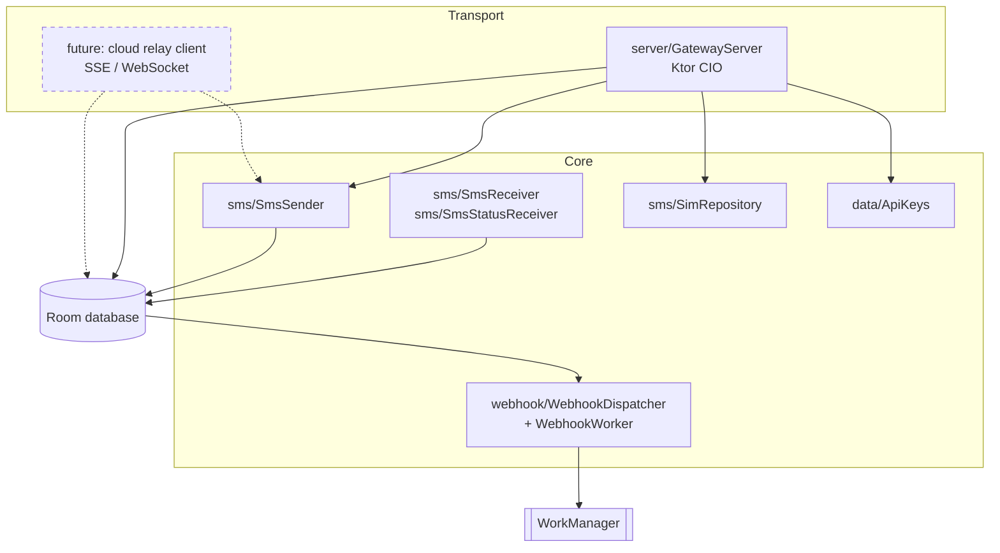

# Contributing

Thanks for helping out! Bug reports, fixes and ideas are all welcome.

- **Bugs and ideas:** open an [issue](https://github.com/jpbaking/sms-gateway-android/issues). For bugs,
  include the phone model, Android version, app version (shown at the bottom of the app), and what
  you sent and got back.
- **Security problems:** please use a [private advisory](https://github.com/jpbaking/sms-gateway-android/security/advisories/new),
  not a public issue.

## Development setup

You need **JDK 17** and the **Android SDK** (Android Studio installs both).

```sh
git clone https://github.com/jpbaking/sms-gateway-android
cd sms-gateway-android
./gradlew assembleDebug        # APK in app/build/outputs/apk/debug/
./gradlew testDebugUnitTest    # unit tests
```

Debug builds install as a separate app (`io.github.jpbaking.smsgateway.debug`), so they can sit next
to a release build on the same phone. SMS needs a real phone with a SIM. The emulator can fake
incoming SMS, but it can't send real ones.

## How the code is organised

```
app/src/main/java/io/github/jpbaking/smsgateway/
├── GatewayApp.kt        app-wide singletons (database, settings, SMS, webhooks)
├── data/                Room database, DAOs, settings, API keys, SecretBox (Keystore encryption)
├── server/              Ktor HTTP API (GatewayServer) and its JSON types (Dto)
├── service/             foreground service that keeps the server alive, boot receiver
├── sms/                 sending per SIM, receiving, sent/delivered callbacks, SIM listing
├── webhook/             webhook dispatch, signing, and the retrying WorkManager worker
├── maintenance/         daily retention purge and database compaction
└── ui/                  Jetpack Compose screens
```



The SMS, storage and webhook code doesn't know about HTTP, so another transport, such as the planned
cloud relay, can sit next to `GatewayServer` without changing it.

## Guidelines

- **Android 9 (API 28) is the minimum.** Guard newer APIs with `Build.VERSION.SDK_INT` checks.
- **Keep it dependency-light.** Prefer the Android SDK and the libraries already in use (Ktor, Room,
  WorkManager, kotlinx.serialization) over adding new ones.
- **Never store secrets in plaintext.** Use `SecretBox` for values the app must read back, and a hash
  for values it only checks (like API keys).
- **Database changes** need a version bump in `AppDatabase` and a `Migration`, so existing installs
  keep their data.
- **API changes** should stay backwards compatible within `/api/v1`. Update [docs/api.md](docs/api.md)
  in the same pull request.
- Add unit tests for logic that doesn't need a phone (signing, retry timing, parsing, and so on).
- Follow the Kotlin [coding conventions](https://kotlinlang.org/docs/coding-conventions.html).

## Pull requests

1. Branch from `main`.
2. Make sure `./gradlew assembleDebug testDebugUnitTest` passes. CI runs the same on every pull request.
3. Describe what changed and how you tested it, including on which phone if it touches SMS.
4. CI attaches a debug APK to every pull request, so reviewers can install and try it.

## Releases (maintainers)

Pushing a version tag builds a signed APK and publishes it on the
[Releases page](https://github.com/jpbaking/sms-gateway-android/releases):

| Tag | Published as |
| --- | --- |
| `v0.2.0-dev.1`, `v0.2.0-alpha.1`, `v0.2.0-beta.1` | Pre-release |
| `v1.0.0` | Full release |

```sh
git checkout main && git pull
git tag v0.1.0-beta.1
git push origin v0.1.0-beta.1
```

The version name comes from the tag. The version code is the workflow run number, which only ever
grows, so every release installs over the previous one.

### One-time signing setup

Android installs an update only if it's signed with the same key as the installed app, so every
release must use the same keystore. Create it once and **back it up somewhere safe**: if it's lost,
users have to uninstall and reinstall.

```sh
keytool -genkeypair -v -keystore release.jks -alias smsgateway \
  -keyalg RSA -keysize 4096 -validity 10000
```

Add these repository secrets (Settings → Secrets and variables → Actions):

```sh
base64 -w0 release.jks | gh secret set SIGNING_KEYSTORE_BASE64   # macOS: base64 -i release.jks | gh secret set …
gh secret set SIGNING_KEYSTORE_PASSWORD
gh secret set SIGNING_KEY_ALIAS      # smsgateway
gh secret set SIGNING_KEY_PASSWORD
```

## License

By contributing, you agree that your contributions are licensed under the project's
[BSD 3-Clause License](LICENSE).
