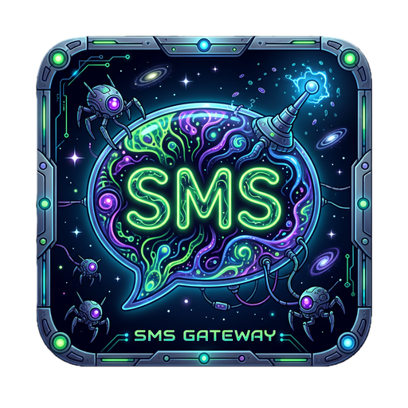
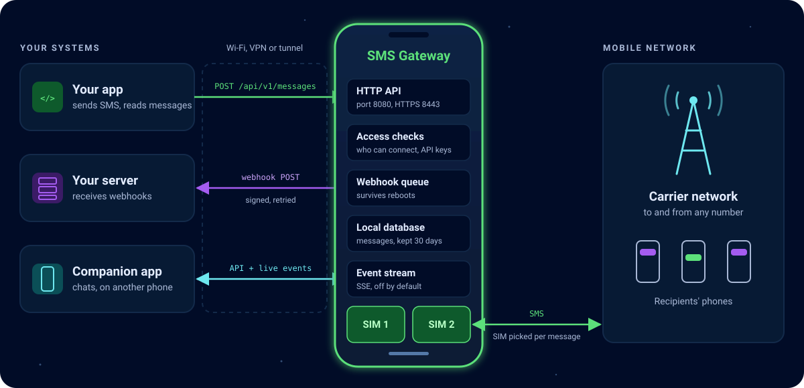
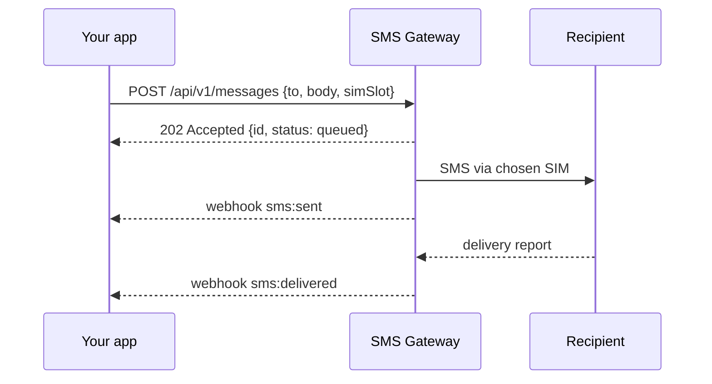
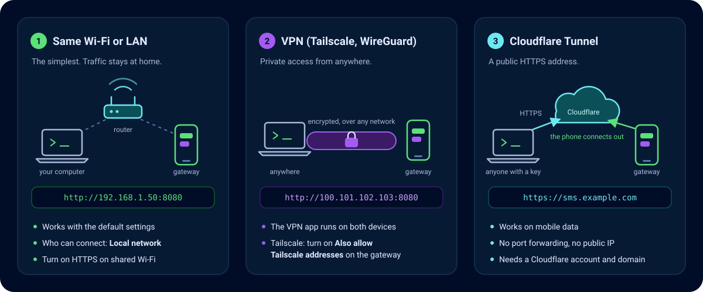

<p align="center">
  
</p>

<h1 align="center">SMS Gateway for Android</h1>

**Turn a spare Android phone into an SMS gateway.** Send and receive text messages from your own apps
over a simple HTTP API, get webhooks for incoming SMS and delivery reports, and choose which SIM
sends each message. Everything runs on the phone: no cloud service, no subscription.

[](https://github.com/jpbaking/sms-gateway-android/actions/workflows/ci.yml)
[](https://github.com/jpbaking/sms-gateway-android/releases)

[](LICENSE)

## Features

- 📤 **Send SMS** with one HTTP call. Long messages are split and joined automatically
- 📥 **Receive SMS** as webhooks, signed with HMAC-SHA256 and retried for up to 3 days while your server is down
- 📡 **Optional live event stream** (Server-Sent Events) with replay after a dropped connection, for client apps
- 💬 **Companion app** for another phone: the gateway's texts as conversations, with contact names and replies on the right SIM. See [Companion app](docs/companion.md)
- 📶 **Dual-SIM and multi-SIM**: pick the SIM per message, and see which SIM received each one
- ✅ **Delivery tracking**: `queued` → `sent` → `delivered` (or `failed`, with the reason)
- 🔑 **Named API keys**: one per app, each with only the permissions it needs, shown once, stored hashed, and recorded on every message
- 🛡️ **Local network only by default**: connections over mobile data or from public addresses are refused before the key is even checked
- 🔒 **Secrets encrypted** with the Android Keystore. Extra webhook headers (e.g. `Authorization`) are supported
- 💾 **Local database** with a retention policy and automatic compaction
- 🔐 **Optional HTTPS**, with a self-signed certificate, your own PEM files, or a PKCS#12 file
- 🌍 **Optional public access** through the built-in Cloudflare Tunnel: a fixed HTTPS address that
  works on mobile data, with no port forwarding
- 🔋 Runs as a foreground service, survives reboots, works on **Android 9 and newer**
- ❓ **Help built in**: the **?** on every screen opens the matching page of the user guide

## How it works

<p align="center">
  
</p>

Your app talks to the phone over HTTP, and the phone does the texting on its own SIM cards. Incoming
SMS and status changes go back to you as webhooks, or live over the event stream. Sending a message
looks like this:



## Download

Every [release](https://github.com/jpbaking/sms-gateway-android/releases) has two APKs:

| File | Install it on | What it is |
| --- | --- | --- |
| `sms-gateway-<version>.apk` | The phone with the SIM cards | **SMS Gateway**, the gateway itself |
| `gateway-sms-companion-<version>.apk` | Another phone (optional) | **Gateway SMS**, a messaging app for the gateway's texts. See [Companion app](docs/companion.md) |

To check a download, compare the output of `sha256sum sms-gateway-*.apk` (macOS:
`shasum -a 256 sms-gateway-*.apk`) with the release's `SHA256SUMS.txt`. Updates install over the
previous version and keep your settings and data.

## Quick start

1. Install `sms-gateway-<version>.apk` on the phone. If Play Protect complains, see
   [Troubleshooting](docs/troubleshooting.md#the-install-is-blocked).
2. Open the app, **Grant permissions**, tap **Allow running in background**, then **Start server**.
3. In **Settings → API keys**, tap **New key** and copy the key.
4. Send a message:

```sh
curl -X POST http://PHONE_IP:8080/api/v1/messages \
  -H "X-API-Key: sgw_your_key" -H "Content-Type: application/json" \
  -d '{"to": "+15551234567", "body": "Hello!", "simSlot": 0}'
```

Full walkthrough: **[Getting started](docs/getting-started.md)**.

## Documentation

The **[user guide](docs/README.md)** covers everything. The app's **?** buttons open it at the
right page.

- [Getting started](docs/getting-started.md): install, set up, send your first SMS
- [The app, screen by screen](docs/settings.md): every setting and its default
- [API reference](docs/api.md)
- [Webhooks](docs/webhooks.md): events, payloads, signature verification, retries
- [Event stream (SSE)](docs/events.md): live events for client apps, off by default
- [Companion app](docs/companion.md): the gateway's texts as chats on another phone
- [Dual-SIM and multi-SIM](docs/multi-sim.md)
- [HTTPS](docs/https.md): self-signed, pasted PEM, or PKCS#12 certificate
- [Public access (Cloudflare Tunnel)](docs/tunnel.md)
- [Security](docs/security.md): API keys, who can connect, how secrets are stored
- [Troubleshooting](docs/troubleshooting.md)

## Good to know

- **Distributed as an APK**, not on the Play Store. Google limits SMS permissions on Play to default
  SMS apps.
- **The phone must be reachable** from your systems: the same network, a VPN such as Tailscale, or
  the built-in [Cloudflare Tunnel](docs/tunnel.md) for a public HTTPS URL. By default it only
  accepts connections from the local network; see
  [Who can connect](docs/security.md#who-can-connect).

  

- **A spare phone on a charger works best**, with a SIM plan that includes SMS and the app allowed
  to run in the background.
- The API is plain HTTP on your network unless you turn on [HTTPS](docs/https.md). Read
  [Security](docs/security.md) before exposing it.
- SMS costs whatever your carrier charges. Check your plan before sending in bulk.

## Roadmap

- Cloud relay: the phone connects out to a server over WebSocket/SSE, so it doesn't need to be
  reachable directly

## Contributing

Pull requests are welcome. See [CONTRIBUTING.md](CONTRIBUTING.md) for the setup, code layout and
release process.

## License

[BSD 3-Clause](LICENSE) © Joseph Baking
