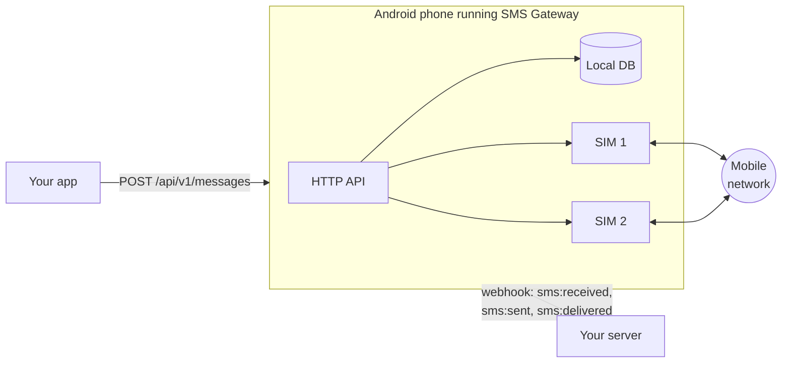
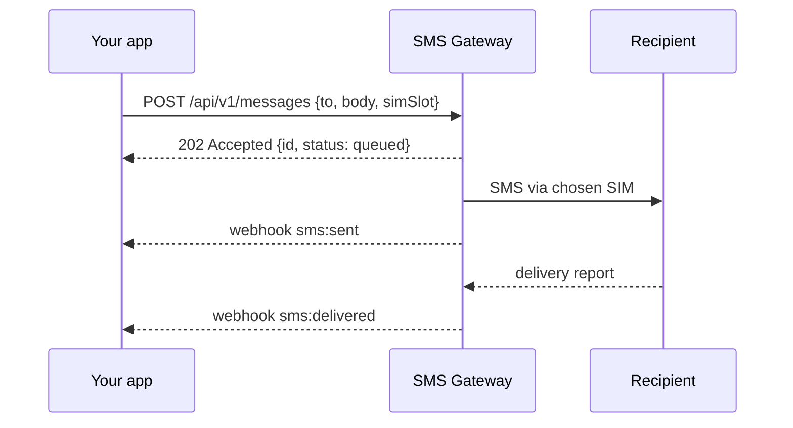

# SMS Gateway for Android

**Turn a spare Android phone into an SMS gateway.** Send and receive text messages from your own apps
over a simple HTTP API, get webhooks for incoming SMS and delivery reports, and choose which SIM
sends each message. Everything runs on the phone: no cloud service, no subscription.

[](https://github.com/jpbaking/sms-gateway-android/actions/workflows/ci.yml)
[](https://github.com/jpbaking/sms-gateway-android/releases)

[](LICENSE)

## Features

- 📤 **Send SMS** with one HTTP call. Long messages are split and joined automatically
- 📥 **Receive SMS** as webhooks, signed with HMAC-SHA256 and retried until your server is back
- 📶 **Dual-SIM and multi-SIM**: pick the SIM per message, and see which SIM received each one
- ✅ **Delivery tracking**: `queued` → `sent` → `delivered` (or `failed`, with the reason)
- 🔑 **Named API keys**: one per app, shown once, stored hashed, revocable, and recorded on every message
- 🔒 **Secrets encrypted** with the Android Keystore. Extra webhook headers (e.g. `Authorization`) are supported
- 💾 **Local database** with a retention policy and automatic compaction
- 🔋 Runs as a foreground service, survives reboots, works on **Android 9 and newer**

## How it works





## Quick start

1. Download the APK from [Releases](https://github.com/jpbaking/sms-gateway-android/releases) and
   install it. If Play Protect complains, see [Troubleshooting](docs/troubleshooting.md#the-install-is-blocked).
2. Open the app, **Grant permissions**, tap **Allow running in background**, then **Start**.
3. Under **API keys**, tap **New key** and copy the key.
4. Send a message:

```sh
curl -X POST http://PHONE_IP:8080/api/v1/messages \
  -H "X-API-Key: sgw_your_key" -H "Content-Type: application/json" \
  -d '{"to": "+15551234567", "body": "Hello!", "simSlot": 0}'
```

Full walkthrough: **[Getting started](docs/getting-started.md)**.

## Documentation

- [Getting started](docs/getting-started.md)
- [API reference](docs/api.md)
- [Webhooks](docs/webhooks.md): events, payloads, signature verification, retries
- [Dual-SIM and multi-SIM](docs/multi-sim.md)
- [Security](docs/security.md)
- [Troubleshooting](docs/troubleshooting.md)

## Good to know

- **Distributed as an APK**, not on the Play Store. Google limits SMS permissions on Play to default
  SMS apps.
- **The phone must be reachable** from your systems: the same network, or a VPN such as Tailscale.
  A cloud relay mode for phones behind NAT is on the roadmap.
- The API is plain HTTP on your network. Read [Security](docs/security.md) before exposing it.
- SMS costs whatever your carrier charges. Check your plan before sending in bulk.

## Roadmap

- Cloud relay: the phone connects out to a server over WebSocket/SSE, so it doesn't need to be
  reachable directly

## Contributing

Pull requests are welcome. See [CONTRIBUTING.md](CONTRIBUTING.md) for the setup, code layout and
release process.

## License

[BSD 3-Clause](LICENSE) © Joseph Baking
