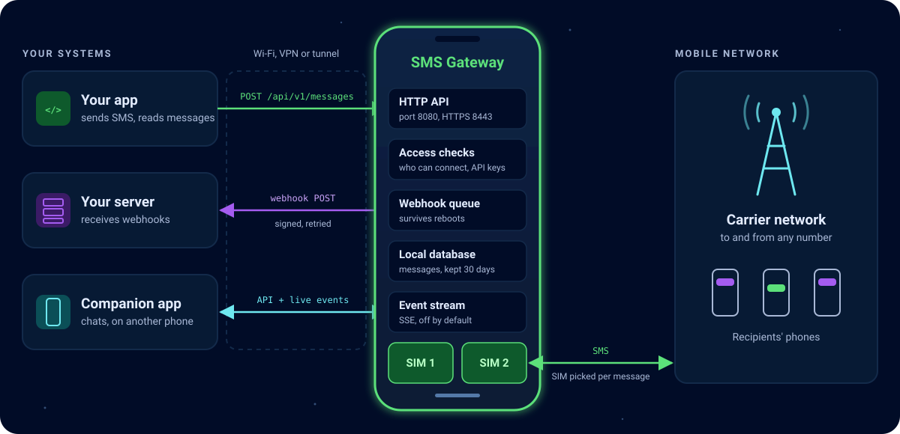
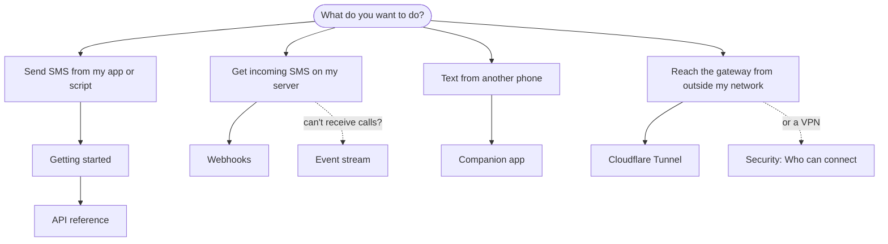
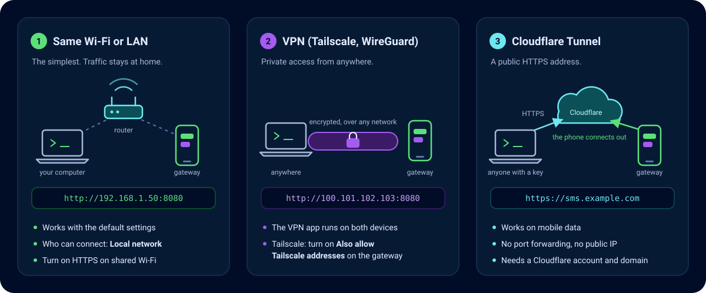

# SMS Gateway user guide

SMS Gateway turns an Android phone into an SMS gateway for your own apps. Start with **Getting
started**, then read the other pages as you need them. In the app, the **?** at the top of each
screen opens the page about that screen.

  

| Page | What it covers |
| --- | --- |
| [Getting started](getting-started.md) | Install the APK, set up the phone, send your first SMS |
| [The app, screen by screen](settings.md) | What each screen shows, and every setting with its default |
| [API reference](api.md) | Every endpoint, with request and response examples |
| [Webhooks](webhooks.md) | Getting incoming SMS and delivery status pushed to your server, verifying signatures, retries |
| [Event stream (SSE)](events.md) | Optional live stream of the same events, for client apps that keep a connection open |
| [Companion app](companion.md) | A messaging app for another phone that shows and sends the gateway's texts |
| [Dual-SIM and multi-SIM](multi-sim.md) | Choosing which SIM sends a message, and telling which SIM received one |
| [HTTPS](https.md) | Serving the API over HTTPS with a self-signed, pasted or PKCS#12 certificate |
| [Public access (Cloudflare Tunnel)](tunnel.md) | Reaching the API from the internet, over mobile data, without opening ports |
| [Security](security.md) | API keys and their permissions, who can connect, how secrets are stored |
| [Troubleshooting](troubleshooting.md) | Install blocks, messages stuck in `sending`, server not reachable, and more |

## Where to start

## How your systems reach the phone

Everything runs on the phone: the HTTP server, the message database, and the webhook queue. No cloud
service is involved, so your app and the phone must be able to reach each other. There are three
ways:

  

1. **The same Wi-Fi or LAN.** Works with the default settings.
2. **A VPN** such as Tailscale or WireGuard, running on both the phone and your computer. For
   Tailscale, turn on **Also allow Tailscale addresses** under [Who can connect](security.md#who-can-connect).
3. **The built-in [Cloudflare Tunnel](tunnel.md)**, for a public HTTPS address that also works when
   the phone is on mobile data.

The gateway decides which of these it accepts under [Who can connect](security.md#who-can-connect).
Whichever you pick, every request still needs an [API key](security.md#api-keys).

## Getting help

- Check [Troubleshooting](troubleshooting.md) first.
- Found a bug, or have an idea? Open an [issue](https://github.com/jpbaking/sms-gateway-android/issues),
  with your phone model, Android version and the app version (**Settings → About**).
- Security problems: please use a [private advisory](https://github.com/jpbaking/sms-gateway-android/security/advisories/new)
  instead.
