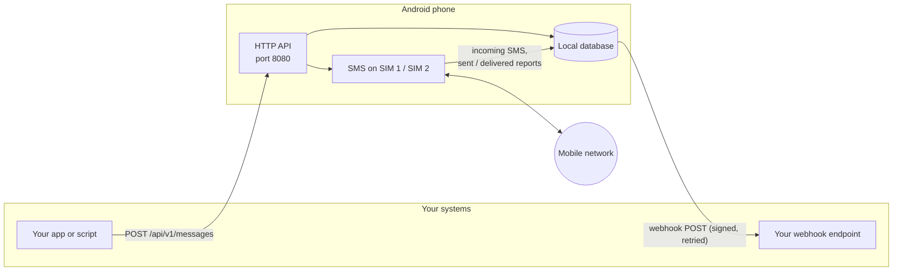

# SMS Gateway user guide

Start with **Getting started**, then read the other pages as you need them.

| Page | What it covers |
| --- | --- |
| [Getting started](getting-started.md) | Install the APK, set up the phone, send your first SMS |
| [API reference](api.md) | Every endpoint, with request and response examples |
| [Webhooks](webhooks.md) | Getting incoming SMS and delivery status pushed to your server, verifying signatures, retries |
| [Event stream (SSE)](events.md) | Optional live stream of the same events, for client apps that keep a connection open |
| [Companion app](companion.md) | A messaging app for another phone that shows and sends the gateway's texts |
| [Dual-SIM and multi-SIM](multi-sim.md) | Choosing which SIM sends a message, and telling which SIM received one |
| [HTTPS](https.md) | Serving the API over HTTPS with a self-signed, pasted or PKCS#12 certificate |
| [Public access (Cloudflare Tunnel)](tunnel.md) | Reaching the API from the internet, over mobile data, without opening ports |
| [Security](security.md) | API keys and their permissions, who can connect, how secrets are stored |
| [Troubleshooting](troubleshooting.md) | Install blocks, messages stuck in `sending`, server not reachable, and more |

## How it fits together

Everything runs on the phone: the HTTP server, the message database, and the webhook queue. No cloud
service is involved, so your app and the phone must be able to reach each other, for example on the
same Wi-Fi or over a VPN such as Tailscale or WireGuard. To reach the phone from the internet
instead, turn on the built-in [Cloudflare Tunnel](tunnel.md). The gateway decides which of these it
accepts under [Who can connect](security.md#who-can-connect); for Tailscale, turn on **Also allow
Tailscale addresses** there.
