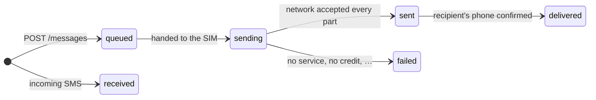

# API reference

Base URL: `http://<phone-ip>:<port>`, shown in the app. The default port is `8080`.

- Requests and responses are JSON (`Content-Type: application/json`).
- Every `/api/v1` endpoint needs an API key, sent as `X-API-Key: <key>` **or**
  `Authorization: Bearer <key>`.
- Each key has [scopes](#scopes) that say what it may do.
- Errors look like `{"error": "what went wrong"}`, with a matching HTTP status.

| Method | Path | Purpose | Scope |
| --- | --- | --- | --- |
| `GET` | [`/health`](#get-health) | Is the server up? | none |
| `GET` | [`/api/v1/sims`](#get-apiv1sims) | List active SIMs | any key |
| `POST` | [`/api/v1/messages`](#post-apiv1messages) | Send an SMS | `send` |
| `GET` | [`/api/v1/messages`](#get-apiv1messages) | List messages | `read`, or `send` for the key's own |
| `GET` | [`/api/v1/messages/{id}`](#get-apiv1messagesid) | Get one message | `read`, or `send` for the key's own |
| `GET` | [`/api/v1/events`](#get-apiv1events) | Live event stream (SSE). Off by default | `events` |
| `GET` | [`/api/v1/webhooks`](#get-apiv1webhooks) | List the key's webhooks | `webhooks` |
| `POST` | [`/api/v1/webhooks`](#post-apiv1webhooks) | Add a webhook | `webhooks` |
| `DELETE` | [`/api/v1/webhooks/{id}`](#delete-apiv1webhooksid) | Remove one of the key's webhooks | `webhooks` |

API keys are managed in the app, not through the API. See [Security](security.md#api-keys).

## Scopes

A key can only do what its scopes allow. You pick them when you create the key, and can change them
later under **Settings → API keys → Permissions**.

| Scope | In the app | Lets the key |
| --- | --- | --- |
| `send` | Send messages | Send SMS, and read the messages it sent itself |
| `read` | Read all messages | Read every message, including incoming ones |
| `events` | Follow the event stream | Open the [event stream](events.md) |
| `webhooks` | Manage its own webhooks | Add, list and remove its own webhooks |
| `send:shortcode` | Send to short codes | Send to numbers of 6 digits or fewer, which can be premium-rate. Needs `send` too |

A new key gets `send` and `read` unless you choose otherwise.

## Status codes for access

| Status | Meaning |
| --- | --- |
| `401` | No key, a key the gateway doesn't know, or a key that is switched off |
| `403` with a JSON body | The key is valid but lacks a scope. The body names it: `{"error": "…", "scope": "events"}` |
| `403` with an empty body | The gateway refuses your address before it looks at the key. See [Who can connect](security.md#who-can-connect) |
| `404` on `/api/v1/events` | The event stream is turned off |

---

## `GET /health`

Without a key it answers `200` with an empty body: enough to tell that the server is up, and nothing
more. With a valid key (any scopes) it adds the details:

```json
{"status": "ok", "version": "0.1.0-beta.1"}
```

With a key that is wrong or switched off it answers `401`, so you can also use it to test a key.

## `GET /api/v1/sims`

Returns the active SIMs, sorted by slot. See [Dual-SIM and multi-SIM](multi-sim.md).

```json
[
  {"subscriptionId": 1, "slot": 0, "displayName": "Work", "carrierName": "Globe", "number": null, "isDefaultSms": true}
]
```

## `POST /api/v1/messages`

Queues an SMS and returns right away with **`202 Accepted`**. Long texts are split into parts
automatically and joined again on the recipient's phone.

| Field | Type | Required | Notes |
| --- | --- | --- | --- |
| `to` | string | yes | Recipient number, ideally in international format (`+15551234567`) |
| `body` | string | yes | Message text |
| `simSlot` | number | no | `0` = SIM 1, `1` = SIM 2, … |
| `subscriptionId` | number | no | A SIM's id from `/sims`. Wins over `simSlot` |

```sh
curl -X POST $GW/api/v1/messages -H "X-API-Key: $KEY" -H "Content-Type: application/json" \
  -d '{"to": "+15551234567", "body": "Your code is 123456", "simSlot": 0}'
```

Response: a [message object](#the-message-object).

Errors: `400` if `to` or `body` is missing, the requested SIM isn't active, or the phone permission
hasn't been granted. `401` if the key is missing, wrong or switched off. `403` if the key lacks
`send`, or if `to` is a short code (6 digits or fewer, not starting with `+`) and the key lacks
`send:shortcode`.

## `GET /api/v1/messages`

Newest first.

| Query | Default | Notes |
| --- | --- | --- |
| `direction` | both | `in` or `out` |
| `limit` | `50` | 1 to 500 |
| `offset` | `0` | For paging |

```json
{"items": [ /* message objects */ ], "limit": 50, "offset": 0}
```

A key with `read` gets every message. A key with `send` but not `read` gets only the messages it
sent itself, and `direction=in` answers `403`. This lets an app that only sends still check on its
own messages, without being able to read incoming ones such as one-time codes.

## `GET /api/v1/messages/{id}`

Returns one [message object](#the-message-object), or `404`. A key without `read` gets `404` for
any message it didn't send.

## The message object

```json
{
  "id": "6f1c…",
  "direction": "out",
  "phoneNumber": "+15551234567",
  "body": "Your code is 123456",
  "subscriptionId": 1,
  "simSlot": 0,
  "status": "delivered",
  "parts": 1,
  "partsSent": 1,
  "partsDelivered": 1,
  "error": null,
  "createdAt": 1762740000000,
  "updatedAt": 1762740004000,
  "apiKeyId": "a2d9…",
  "apiKeyName": "billing-app"
}
```

- Times are Unix **milliseconds**.
- `phoneNumber` is the recipient for `out` and the sender for `in`.
- `apiKeyId` and `apiKeyName` say which key sent an outgoing message. They are `null` for incoming
  messages.

### Message status



`delivered` depends on your carrier sending delivery reports. Many do, some don't, so a message can
stay at `sent` for good.

## `GET /api/v1/events`

A [Server-Sent Events](events.md) stream of the same events webhooks get, with replay after a
dropped connection through `Last-Event-ID`. **Off by default**: it answers `404` until you turn it
on under **Settings → Event stream**. The key needs the `events` scope.

| Query or header | Notes |
| --- | --- |
| `Last-Event-ID` header, or `lastEventId` query | Replay every event after this id. Without it, only new events |
| `events` query | Comma-separated event names. Default: all |

```sh
curl -N $GW/api/v1/events -H "X-API-Key: $KEY" -H "Last-Event-ID: 41"
```

Format, heartbeats and reconnecting: see [Event stream](events.md).

## `GET /api/v1/webhooks`

Lists the webhooks **this key** registered. A key never sees another key's webhooks, or the ones
added on the phone. The app shows all of them under **Settings → Webhooks**.

```json
[
  {
    "id": "c3b1…",
    "url": "https://example.com/sms",
    "events": ["sms:received", "sms:sent", "sms:delivered", "sms:failed"],
    "secret": null,
    "headers": [{"key": "Authorization", "value": "********", "isSecret": true}],
    "insecure": false,
    "enabled": true,
    "createdAt": 1762740000000
  }
]
```

The signing `secret` is only returned when the webhook is created. Secret header values are masked.
`enabled` is `false` while the webhook is switched off on the phone; nothing is delivered to it
then.

## `POST /api/v1/webhooks`

| Field | Type | Required | Notes |
| --- | --- | --- | --- |
| `url` | string | yes | `http://` or `https://` |
| `events` | string[] | no | Any of `sms:received`, `sms:sent`, `sms:delivered`, `sms:failed`. Default: all |
| `secret` | string | no | Signing secret. Generated if omitted |
| `headers` | object[] | no | `{"key", "value", "isSecret"}`, sent with every delivery. `isSecret` defaults to `false` |
| `insecure` | boolean | no | Skip TLS certificate and host name checks, for `https://` servers with self-signed or dev/test certificates. Default `false` |

```sh
curl -X POST $GW/api/v1/webhooks -H "X-API-Key: $KEY" -H "Content-Type: application/json" -d '{
  "url": "https://example.com/sms",
  "events": ["sms:received"],
  "headers": [{"key": "Authorization", "value": "Bearer abc123", "isSecret": true}]
}'
```

Returns **`201 Created`** with the webhook, including its `secret`. **Save the secret**: it isn't
shown again.

The webhook belongs to the key that added it: it is paused while that key is switched off, and
deleted when the key is revoked. The phone shows a notification each time a webhook is added through
the API.

Answers `403` when **Manage webhooks on this phone only** is on (**Settings → Webhooks**). Webhooks
are then added in the app instead.

Up to 20 headers. These names are reserved and rejected: `Content-Type`, `Content-Length`, `Host`,
`Connection`, `Transfer-Encoding` and anything starting with `X-Gateway-`.

`"insecure": true` accepts any certificate from that webhook's server, so deliveries still work
when it uses a self-signed, expired or wrong-host certificate. The traffic is still encrypted, but
anyone on the network path could pretend to be your server. Use it for dev and test only. It only
affects that one webhook, and has no effect on `http://` URLs.

## `DELETE /api/v1/webhooks/{id}`

Returns `204`, or `404` if there is no such webhook or another key registered it. Any retries still
pending for this webhook stop. Answers `403` when **Manage webhooks on this phone only** is on.
