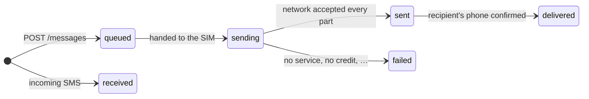

# API reference

Base URL: `http://<phone-ip>:<port>`, shown in the app. The default port is `8080`.

- Requests and responses are JSON (`Content-Type: application/json`).
- Every `/api/v1` endpoint needs an API key, sent as `X-API-Key: <key>` **or**
  `Authorization: Bearer <key>`.
- Errors look like `{"error": "what went wrong"}`, with a matching HTTP status.

| Method | Path | Purpose |
| --- | --- | --- |
| `GET` | [`/health`](#get-health) | Is the server up? (no key needed) |
| `GET` | [`/api/v1/sims`](#get-apiv1sims) | List active SIMs |
| `POST` | [`/api/v1/messages`](#post-apiv1messages) | Send an SMS |
| `GET` | [`/api/v1/messages`](#get-apiv1messages) | List messages |
| `GET` | [`/api/v1/messages/{id}`](#get-apiv1messagesid) | Get one message |
| `GET` | [`/api/v1/webhooks`](#get-apiv1webhooks) | List webhooks |
| `POST` | [`/api/v1/webhooks`](#post-apiv1webhooks) | Add a webhook |
| `DELETE` | [`/api/v1/webhooks/{id}`](#delete-apiv1webhooksid) | Remove a webhook |

API keys are managed in the app, not through the API. See [Security](security.md#api-keys).

---

## `GET /health`

```json
{"status": "ok", "version": "0.1.0-beta.1"}
```

## `GET /api/v1/sims`

Returns the active SIMs, sorted by slot. See [Dual-SIM and multi-SIM](multi-sim.md).

```json
[
  {"subscriptionId": 1, "slot": 0, "displayName": "Work", "carrierName": "Globe", "number": null, "isDefaultSms": true}
]
```

## `POST /api/v1/messages`

Queues an SMS and returns right away with **`202 Accepted`**. Long texts are split into parts
automatically and joined again on the recipient's phone.

| Field | Type | Required | Notes |
| --- | --- | --- | --- |
| `to` | string | yes | Recipient number, ideally in international format (`+15551234567`) |
| `body` | string | yes | Message text |
| `simSlot` | number | no | `0` = SIM 1, `1` = SIM 2, … |
| `subscriptionId` | number | no | A SIM's id from `/sims`. Wins over `simSlot` |

```sh
curl -X POST $GW/api/v1/messages -H "X-API-Key: $KEY" -H "Content-Type: application/json" \
  -d '{"to": "+15551234567", "body": "Your code is 123456", "simSlot": 0}'
```

Response: a [message object](#the-message-object).

Errors: `400` if `to` or `body` is missing, the requested SIM isn't active, or the phone permission
hasn't been granted. `401` if the key is missing or wrong.

## `GET /api/v1/messages`

Newest first.

| Query | Default | Notes |
| --- | --- | --- |
| `direction` | both | `in` or `out` |
| `limit` | `50` | 1 to 500 |
| `offset` | `0` | For paging |

```json
{"items": [ /* message objects */ ], "limit": 50, "offset": 0}
```

## `GET /api/v1/messages/{id}`

Returns one [message object](#the-message-object), or `404`.

## The message object

```json
{
  "id": "6f1c…",
  "direction": "out",
  "phoneNumber": "+15551234567",
  "body": "Your code is 123456",
  "subscriptionId": 1,
  "simSlot": 0,
  "status": "delivered",
  "parts": 1,
  "partsSent": 1,
  "partsDelivered": 1,
  "error": null,
  "createdAt": 1762740000000,
  "updatedAt": 1762740004000,
  "apiKeyId": "a2d9…",
  "apiKeyName": "billing-app"
}
```

- Times are Unix **milliseconds**.
- `phoneNumber` is the recipient for `out` and the sender for `in`.
- `apiKeyId` and `apiKeyName` say which key sent an outgoing message. They are `null` for incoming
  messages.

### Message status



`delivered` depends on your carrier sending delivery reports. Many do, some don't, so a message can
stay at `sent` for good.

## `GET /api/v1/webhooks`

```json
[
  {
    "id": "c3b1…",
    "url": "https://example.com/sms",
    "events": ["sms:received", "sms:sent", "sms:delivered", "sms:failed"],
    "secret": null,
    "headers": [{"key": "Authorization", "value": "********", "isSecret": true}],
    "createdAt": 1762740000000
  }
]
```

The signing `secret` is only returned when the webhook is created. Secret header values are masked.

## `POST /api/v1/webhooks`

| Field | Type | Required | Notes |
| --- | --- | --- | --- |
| `url` | string | yes | `http://` or `https://` |
| `events` | string[] | no | Any of `sms:received`, `sms:sent`, `sms:delivered`, `sms:failed`. Default: all |
| `secret` | string | no | Signing secret. Generated if omitted |
| `headers` | object[] | no | `{"key", "value", "isSecret"}`, sent with every delivery. `isSecret` defaults to `false` |

```sh
curl -X POST $GW/api/v1/webhooks -H "X-API-Key: $KEY" -H "Content-Type: application/json" -d '{
  "url": "https://example.com/sms",
  "events": ["sms:received"],
  "headers": [{"key": "Authorization", "value": "Bearer abc123", "isSecret": true}]
}'
```

Returns **`201 Created`** with the webhook, including its `secret`. **Save the secret**: it isn't
shown again.

Up to 20 headers. These names are reserved and rejected: `Content-Type`, `Content-Length`, `Host`,
`Connection`, `Transfer-Encoding` and anything starting with `X-Gateway-`.

## `DELETE /api/v1/webhooks/{id}`

Returns `204`, or `404`. Any retries still pending for this webhook stop.
