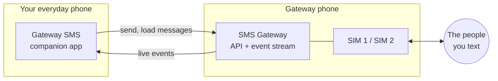
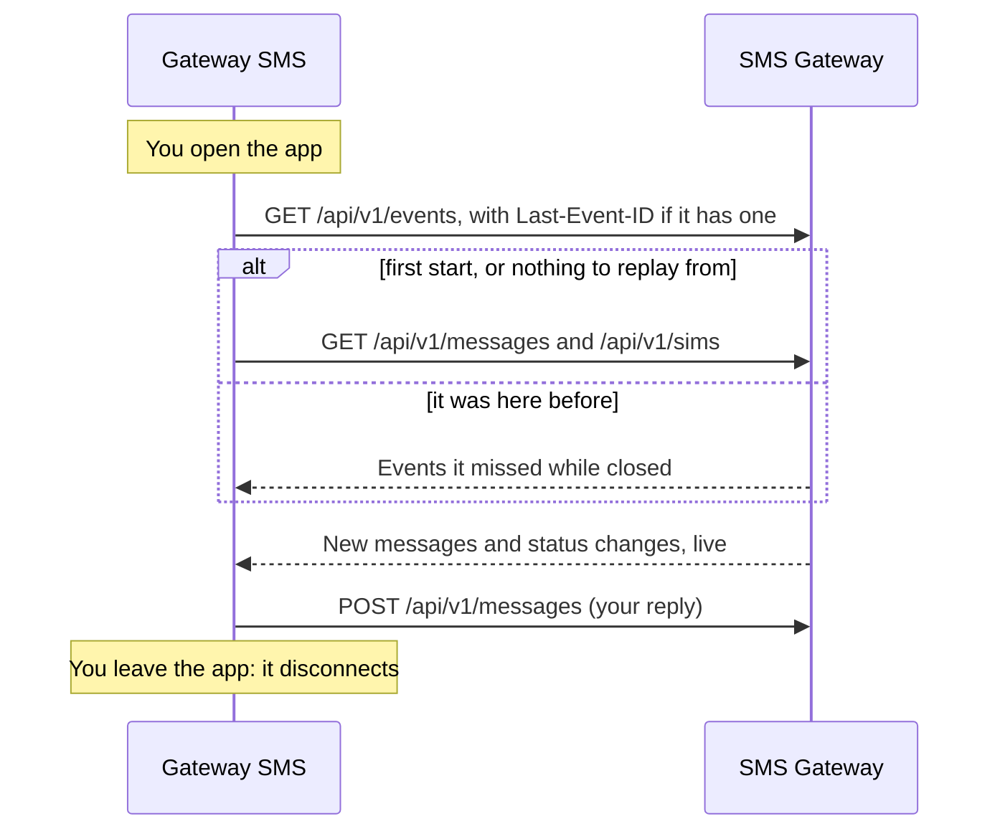
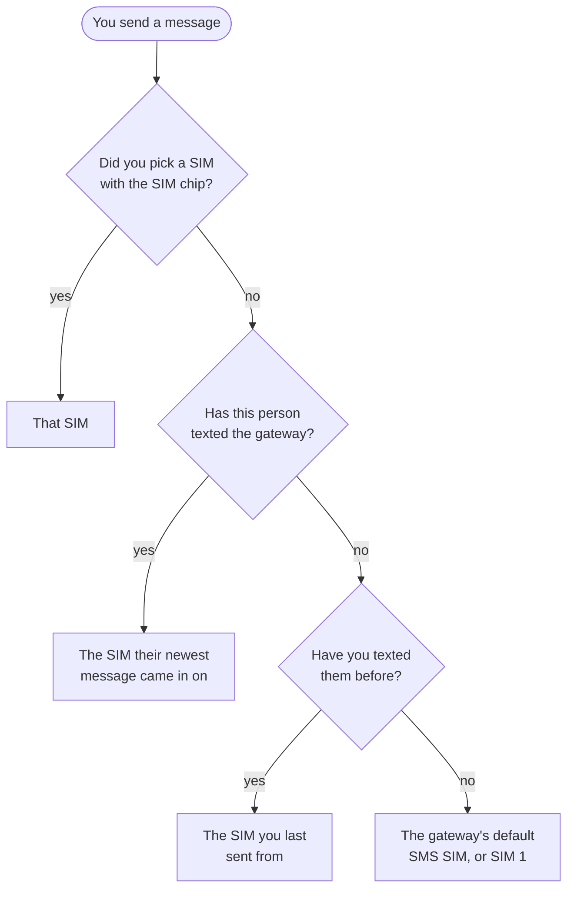

# Companion app (Gateway SMS)

**Gateway SMS** is a small messaging app for *another* phone. It shows the gateway's texts as
conversations, like a normal SMS app, and sends and replies through the gateway. It lives in
[`companion/`](../companion) and installs next to the gateway app as its own app.

It only ever shows the gateway's messages. It doesn't read, send or mix in the SMS of the phone it
runs on.

## What it does

- **Conversations** with each number, newest first, with unread counts. Names and photos come from
  the phone's contacts when the number is saved there (it asks for the contacts permission; without
  it, numbers are shown).
- **Threads** with sent and received bubbles, day separators, and each sent message's status
  (`Sending…`, `Sent`, `Delivered`, or `Not sent`, tap to retry). Long-press a message to copy it.
- **Reply and start new chats**: pick a contact, a recent conversation, or type a number.
- **SIM picked for you**: a reply goes out on the SIM the newest *received* message in that
  conversation came in on, so the other side sees the reply from the number they texted. Without a
  received message it uses the SIM last sent from, then the gateway's default SMS SIM. Tap the SIM
  chip above the text box to choose another one for that conversation. See
  [Which SIM a reply uses](#which-sim-a-reply-uses).
- **Live updates while it's open** through the [event stream](events.md). There is no background
  service: nothing is connected while the app is closed, and when it's opened again the stream
  replays what was missed (`Last-Event-ID`), or the app reloads. If the gateway's event stream is
  off, the app refreshes every 15 seconds while it's open instead.

## Set up

1. On the gateway phone, create an API key for this phone, e.g. `my-phone`
   (**Settings → API keys → New key**). Tick **Send messages**, **Read all messages** and, for
   live updates, **Follow the event stream**. Leave the other permissions off: the app doesn't use
   them.
2. For live updates, turn on **Settings → Event stream** on the gateway.
3. Install the companion APK on the other phone (Android 9 or newer). Download the latest
   `gateway-sms-companion-*.apk` from the
   [Releases page](https://github.com/jpbaking/sms-gateway-android/releases), next to the gateway's
   own APK. It has the same version as the gateway release it came with.
4. Enter the gateway URL and the API key, and tap **Save**. The app checks both before saving.

| Gateway URL | When |
| --- | --- |
| `http://192.168.1.50:8080` | Both phones on the same Wi-Fi, plain HTTP |
| `https://192.168.1.50:8443` | Same Wi-Fi, gateway [serving HTTPS](https.md) |
| `https://sms.example.com` | Through the [Cloudflare Tunnel](tunnel.md), from anywhere |

Typing just `192.168.1.50:8080` or `sms.example.com` works too: an IP address gets `http://`,
a host name gets `https://`.

With an `http://` address the app shows a warning: the API key and your messages cross the network
unencrypted, so anyone on the same Wi-Fi could read them. Use it on a network you trust, or turn on
[HTTPS](https.md) on the gateway.

The gateway's default **Local network** mode only accepts connections from the same network. To use
the app from elsewhere, connect through the [Cloudflare Tunnel](tunnel.md) or a VPN. See
[Who can connect](security.md#who-can-connect).

## How it stays up to date

Without the event stream (turned off on the gateway, or a key without **Follow the event stream**),
the app loads messages every 15 seconds while it's open instead.

## Which SIM a reply uses

## Self-signed certificates

A gateway serving HTTPS with its own self-signed certificate isn't trusted by Android. When you tap
**Save**, the app shows that certificate's SHA-256 fingerprint. Compare it with the one in the
gateway app under **Settings → Server → Certificate**, and tap **Trust** only if they match. You can
also paste the fingerprint into **Trusted fingerprint** yourself.

The app then trusts exactly that certificate (it's pinned), whatever IP address or host name it's
reached by, plus anything Android trusts anyway, such as the tunnel's certificate. If the gateway
gets a new certificate, Save shows the new fingerprint to compare again.

## Good to know

- The API key is stored encrypted with the Android Keystore, and is left out of backups and of the
  copy Android makes when you move to a new phone. Enter it again there.
- The app never follows a redirect. If the address you entered answers with one, the app says so
  and sends the API key nowhere else. Enter the gateway's own URL.
- Without the **Follow the event stream** permission the key can't open the stream, and the app
  refreshes every 15 seconds while it's open instead.
- The app loads the newest 500 messages, and **Load older messages** fetches more.
- Messages the app sends are recorded on the gateway under its API key's name.

## Troubleshooting

| What you see | What to do |
| --- | --- |
| "Can't reach the gateway" | Check that the gateway's server is running and that this phone can reach it: on the same Wi-Fi, over a VPN, or through the [tunnel](tunnel.md). Over mobile data, only the tunnel works by default. See [I can't reach the server](troubleshooting.md#i-cant-reach-the-server) |
| "The gateway didn't accept the API key" | The key was revoked, regenerated or switched off on the gateway. Create a new one there, and enter it under **Settings** |
| "The gateway's certificate isn't trusted" | The gateway has a new certificate, or one this phone was never told to trust. Tap **Save** in **Settings**, compare the fingerprint it shows with the one in the gateway app, and tap **Trust** if they match |
| "The address answered with a redirect" | The URL doesn't point at the gateway itself, for example a login page or a different port. Enter the address the gateway shows on its **Status** tab |
| "No live updates, so this refreshes every 15 seconds" | Turn on **Settings → Event stream** on the gateway, and give this phone's key the **Follow the event stream** permission |
| A `403` error when sending or loading | The key lacks a permission. On the gateway, open **Settings → API keys → Permissions** for it and tick **Send messages** and **Read all messages** |
| Numbers instead of names | Allow the contacts permission. The banner at the top of the list offers it again |
