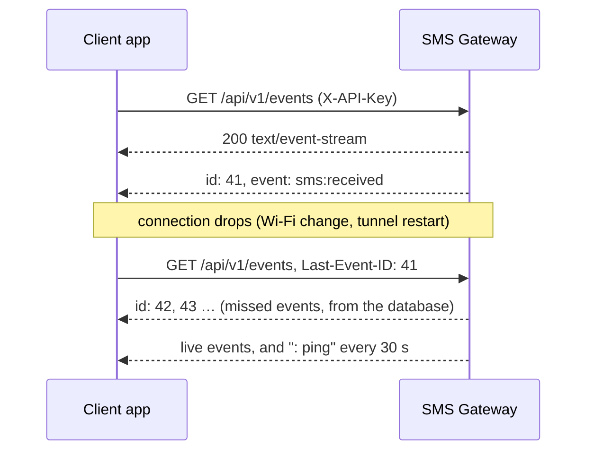

# Event stream (SSE)

The event stream pushes the same events as [webhooks](webhooks.md) to any app that keeps a
connection open to the phone, using [Server-Sent Events](https://html.spec.whatwg.org/multipage/server-sent-events.html).
It suits apps that can't receive webhooks, because nothing has to call **them**: a client app on
another phone, a desktop dashboard, or a script behind NAT.

It is **off by default**. While it's off, `GET /api/v1/events` isn't served at all and answers
`404`, like any unknown path.



## Turn it on

In the app, go to **Settings → Event stream**, tap **Edit**, switch on **Serve the event stream**
and tap **Save**, then confirm. The card shows how many clients are connected.

Turning it off disconnects connected clients, makes the endpoint answer `404` again, and stops
storing new events for it.

## Connect

```sh
curl -N $GW/api/v1/events -H "X-API-Key: $KEY"
```

| Query or header | Notes |
| --- | --- |
| `X-API-Key` or `Authorization: Bearer` | Required. The key needs the `events` [scope](api.md#scopes) |
| `Last-Event-ID` header | Id of the last event you handled. You get every event after it, then live events. Without it, only new events are sent |
| `lastEventId` query | Same as the header, for clients that can't set it on the first connection |
| `events` query | Comma-separated event names to receive, e.g. `events=sms:received`. Default: all |

The response is `200` with `Content-Type: text/event-stream` and stays open. Errors are answered
before the stream starts: `401` for a missing or wrong key, `403` for a key without the `events`
scope, `400` for an unknown event name or a `Last-Event-ID` that isn't a number, and `404` while
the stream is off.

A stream belongs to the key that opened it. The gateway closes it when that key is switched off,
regenerated or revoked, or loses the `events` scope. A client that reconnects then gets `401` or
`403`, so treat those as "stop and tell the user", not as a reason to keep retrying.

## What you receive

```text
retry: 5000

id: 42
event: sms:received
data: {"id":"9a1b…","event":"sms:received","timestamp":1762740000123,"message":{"id":"6f1c…","direction":"in","phoneNumber":"+15551234567","body":"STOP","simSlot":1,"subscriptionId":2,"status":"received","…":"…"}}

: ping
```

- **`event`** is one of the [webhook events](webhooks.md#events): `sms:received`, `sms:sent`,
  `sms:delivered`, `sms:failed`.
- **`data`** is exactly the JSON body a webhook gets, on one line. `message` is the
  [message object](api.md#the-message-object).
- **`id`** is the event's number on this phone. It only goes up. Save the last one you handled.
- **`: ping`** is a comment, sent when nothing else was sent for 30 seconds. SSE clients ignore it.
  It keeps the connection alive through proxies, in particular the
  [Cloudflare Tunnel](tunnel.md), which closes connections that are idle for about 100 seconds.
- **`retry: 5000`** asks clients to wait 5 seconds before reconnecting.

## Reconnecting without missing anything

While the stream is on, every event is also kept in the phone's database, so a client that comes
back with `Last-Event-ID` gets what it missed. Browsers' `EventSource` does this by itself; with
other clients, send the header yourself.

Events are kept as long as messages (**Settings → Storage**), and at most the newest 10,000. Events
that happened while the stream was off are never stored.

If the stream can't fill the gap, it sends this first:

```text
event: resync
data: {"lastEventId":5}
```

That happens when the events after your `Last-Event-ID` were already cleaned up, or when the id is
newer than anything on the phone (for example after the app's data was cleared). Reload what you
show from [`GET /api/v1/messages`](api.md#get-apiv1messages), then carry on with the stream.

## Building a client app

A typical client, such as an app on a second phone that shows the gateway's SMS and sends through
it, does this:

1. On start, load history with `GET /api/v1/messages?limit=100` (page with `offset`), and the SIMs
   with `GET /api/v1/sims`.
2. Open `GET /api/v1/events` and apply each event by `message.id`: insert it if new, otherwise
   replace it. `sms:sent`, `sms:delivered` and `sms:failed` carry the full updated message.
3. Save the last `id` you applied. Reconnect with it as `Last-Event-ID` after a drop, waiting a few
   seconds between tries. On `resync`, reload from step 1.
4. Send with `POST /api/v1/messages`, picking the SIM with `simSlot` or `subscriptionId`. The
   reply is the queued message; its status changes arrive on the stream.

Give the client app **its own API key** (for example `my-phone`), so you can revoke it alone and
see which messages it sent. For the steps above it needs the `send`, `read` and `events` scopes,
and nothing else.

On Android, keep the connection in a foreground service if you want it while the app is in the
background, since the system closes idle network connections of background apps. OkHttp's
[`okhttp-sse`](https://square.github.io/okhttp/) reads the stream and lets you set the
`X-API-Key` and `Last-Event-ID` headers.

## Good to know

- **Browsers:** `EventSource` can't send custom headers, so it can't send the API key. Use a
  `fetch`-based SSE library, or call the stream from your own backend.
- **Battery:** each connected client keeps a connection open on the phone. A handful is fine.
- **Webhooks and the stream are independent.** Use either or both. The stream doesn't retry: a
  client that is gone simply catches up with `Last-Event-ID` when it's back.
