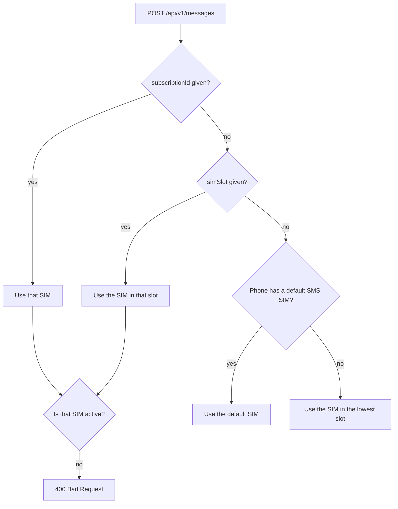

# Dual-SIM and multi-SIM

The gateway works with every active SIM in the phone, physical or eSIM.

## See your SIMs

```sh
curl -H "X-API-Key: $KEY" $GW/api/v1/sims
```

```json
[
  {"subscriptionId": 1, "slot": 0, "displayName": "Work", "carrierName": "Globe", "number": null, "isDefaultSms": true},
  {"subscriptionId": 2, "slot": 1, "displayName": "Personal", "carrierName": "Smart", "number": "+639...", "isDefaultSms": false}
]
```

- **`slot`** is the physical position, counted from zero: `0` is SIM 1, `1` is SIM 2.
- **`subscriptionId`** is Android's id for that SIM. It stays the same while the SIM stays in the
  phone, even if you move it to the other slot.
- **`number`** is often `null`, because many carriers don't store the number on the SIM.

## Choose the SIM for a message



```sh
# SIM 2 by slot
-d '{"to": "+15551234567", "body": "Hi", "simSlot": 1}'

# A specific SIM, wherever it sits
-d '{"to": "+15551234567", "body": "Hi", "subscriptionId": 2}'
```

Use `simSlot` when you think in terms of "SIM 1 / SIM 2". Use `subscriptionId` when a particular
SIM card must send, even if someone swaps the slots.

## Which SIM received a message

Incoming messages carry the `simSlot` and `subscriptionId` they arrived on, in the API and in the
`sms:received` webhook. Use that to route replies, for example "anything that arrives on SIM 2 goes
to support".

## Tips

- Sending from a SIM with no credit or no signal ends in `failed` with an error such as
  `Send failed (no service)`.
- If the phone is set to "Ask every time" for SMS, there's no default SIM. The gateway then uses the
  lowest slot unless you pick one.
