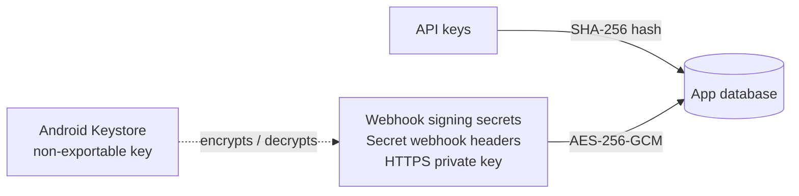

# Security

## API keys

- Make **one key per app or person**, named so you can recognise it, e.g. `billing-app`. Every
  outgoing message records the key that sent it.
- The key is **shown once**, when you create or regenerate it. The phone stores only a SHA-256
  hash, so nobody can read the key back, not even the app.
- **Give each key only the permissions it needs.** A new key can send and read messages. Following
  the event stream, managing webhooks and sending to short codes are separate permissions that you
  turn on per key. See [Scopes](api.md#scopes).
- **Switch a key off** to stop it without deleting it. Its requests are refused, its webhooks are
  paused and any event stream it has open is closed. Switch it back on and everything resumes.
- **Regenerate** gives a key a new value under the same name. The old value stops working at once.
- **Revoke** deletes the key, together with the webhooks it registered. Messages it already sent
  keep its name.
- The list shows each key's first characters (`sgw_1a2b3c4d…`) and when it was last used, so you can
  spot keys that are no longer needed.

### Which permissions matter most

A key that can **manage webhooks** or **follow the event stream** can receive every incoming SMS,
which includes one-time codes sent to the phone's number. Give those two only to systems you would
trust with your SMS inbox. A webhook also keeps working after the request that made it, so the app
tells you about each one: the phone shows a notification when a webhook is added through the API,
and **Settings → Webhooks** lists them all, with the key that added each.

If no integration needs to add webhooks by itself, turn on **Manage webhooks on this phone only**
there. The API then can't add or remove webhooks at all.

**Send to short codes** covers numbers of 6 digits or fewer. Some of those are premium-rate and
cost money per message, so a key can't send to them unless you allow it.

### Keys from before permissions existed

Keys made with an earlier version keep working exactly as before, with every permission. The app
marks each one with **Review this key**, and the Status tab reminds you. Open **Permissions** on
the key, keep only what it needs and save. Saving also clears the mark.

## How secrets are stored on the phone

- **Webhook signing secrets**, headers marked `isSecret`, the tunnel token and the **HTTPS private
  key** are encrypted with an AES-256 key held in the **Android Keystore**. That key can't be
  exported from the phone, so a copy of the app's files doesn't reveal the secrets.
- Secret header values are shown as `********` when you list webhooks. The signing secret is only
  returned when the webhook is created.
- Nothing is backed up or transferred: the database and settings are left out of cloud backups, and
  also out of the copy Android makes when you move to a new phone. On a new phone you set the
  gateway up again and create new keys.
- Message text and phone numbers are stored in the app's private storage, which other apps can't read,
  but they aren't encrypted separately.

## Who can connect

Before the gateway looks at an API key, it checks where the connection comes from. You choose under
**Settings → Server → Who can connect**:

| Mode | Lets in |
| --- | --- |
| **Tunnel only** | Nothing but the [Cloudflare Tunnel](tunnel.md). The server listens on the phone itself only, so nothing on Wi-Fi can connect, and HTTPS isn't served |
| **Local network** (default) | Devices on the same Wi-Fi, Ethernet or VPN, plus the tunnel |
| **Anywhere** | Everything that can reach the phone. If the phone has a public address, that means the internet |

In **Local network** mode a connection is let in when it comes from a private address
(`10.0.0.0/8`, `172.16.0.0/12`, `192.168.0.0/16`, `169.254.0.0/16`, `fc00::/7`, `fe80::/10`) or from
the phone itself. Two more rules apply:

- **Nothing is accepted over mobile data**, whatever address it claims to come from. Mobile
  carriers hand out private-looking addresses too, and some give phones a public IPv6 address.
- **Tailscale addresses** (`100.64.0.0/10`) are refused unless you turn on **Also allow Tailscale
  addresses**. Carriers use the same range, so leave it off if you don't use Tailscale.

A refused connection gets `403` with an empty body over HTTP. Over HTTPS it is closed before the
TLS handshake.

This check is one layer, not the only one. Every request still needs an API key.

## The network

By default the server speaks plain **HTTP** on the port you choose. Treat the phone like any other
server:

- **Turn on [HTTPS](https.md)** so API keys and messages are encrypted on the network. With HTTPS
  on, plain HTTP only answers on the phone itself unless you allow it.
- **Use a trusted network.** Over plain HTTP on shared or public Wi-Fi, anyone nearby could see API
  traffic, including your key.
- **For access from outside your network, use a VPN** such as Tailscale or WireGuard, or the
  [Cloudflare Tunnel](tunnel.md). Don't port-forward the gateway to the internet: in **Local
  network** mode the gateway refuses those connections anyway.
- Use `https://` webhook URLs when the receiving server is outside your local network.
- Keep `"insecure": false` (the default) on webhooks. `true` skips certificate checks for that
  webhook, so anyone on the network path could receive its deliveries. Use it for dev/test servers
  with self-signed certificates only.
- Revoke keys you no longer use.
- Leave the [event stream](events.md) off unless you use it. When it's on, any key with the
  `events` scope can follow every incoming SMS live, and recent events are kept in the database for
  replay.

## Webhook signatures

Every webhook is signed. Verify it on your server so nobody else can fake incoming SMS. See
[Webhooks → Verify the signature](webhooks.md#verify-the-signature).

## Reporting a vulnerability

Please open a [private security advisory](https://github.com/jpbaking/sms-gateway-android/security/advisories/new)
rather than a public issue.
