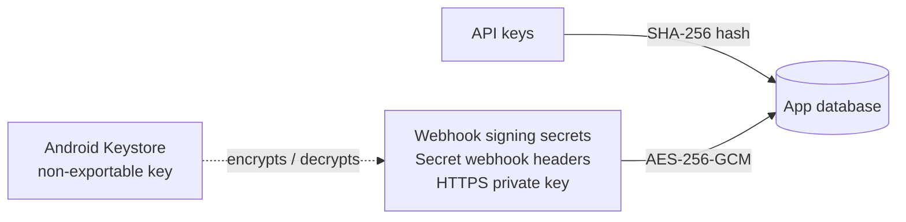

# Security

## API keys

- Make **one key per app or person**, named so you can recognise it, e.g. `billing-app`. Every
  outgoing message records the key that sent it.
- The key is **shown once**, when you create or regenerate it. The phone stores only a SHA-256
  hash, so nobody can read the key back, not even the app.
- **Regenerate** gives a key a new value under the same name. The old value stops working at once.
- **Revoke** deletes the key. Messages it already sent keep its name.
- The list shows each key's first characters (`sgw_1a2b3c4d…`) and when it was last used, so you can
  spot keys that are no longer needed.

## How secrets are stored on the phone

- **Webhook signing secrets**, headers marked `isSecret`, the tunnel token and the **HTTPS private
  key** are encrypted with an AES-256 key held in the **Android Keystore**. That key can't be
  exported from the phone, so a copy of the app's files doesn't reveal the secrets.
- Secret header values are shown as `********` when you list webhooks. The signing secret is only
  returned when the webhook is created.
- App backups are turned off, so the database isn't copied to cloud backups.
- Message text and phone numbers are stored in the app's private storage, which other apps can't read,
  but they aren't encrypted separately.

## The network

By default the server speaks plain **HTTP** on the port you choose, on every network the phone is
connected to. Treat the phone like any other server:

- **Turn on [HTTPS](https.md)** so API keys and messages are encrypted on the network. With HTTPS
  on, plain HTTP only answers on the phone itself unless you allow it.
- **Use a trusted network.** Over plain HTTP on shared or public Wi-Fi, anyone nearby could see API
  traffic, including your key.
- **For access from outside your network, use a VPN** such as Tailscale or WireGuard. Don't
  port-forward the gateway to the internet.
- Use `https://` webhook URLs when the receiving server is outside your local network.
- Keep `"insecure": false` (the default) on webhooks. `true` skips certificate checks for that
  webhook, so anyone on the network path could receive its deliveries. Use it for dev/test servers
  with self-signed certificates only.
- Revoke keys you no longer use.

## Webhook signatures

Every webhook is signed. Verify it on your server so nobody else can fake incoming SMS. See
[Webhooks → Verify the signature](webhooks.md#verify-the-signature).

## Reporting a vulnerability

Please open a [private security advisory](https://github.com/jpbaking/sms-gateway-android/security/advisories/new)
rather than a public issue.
