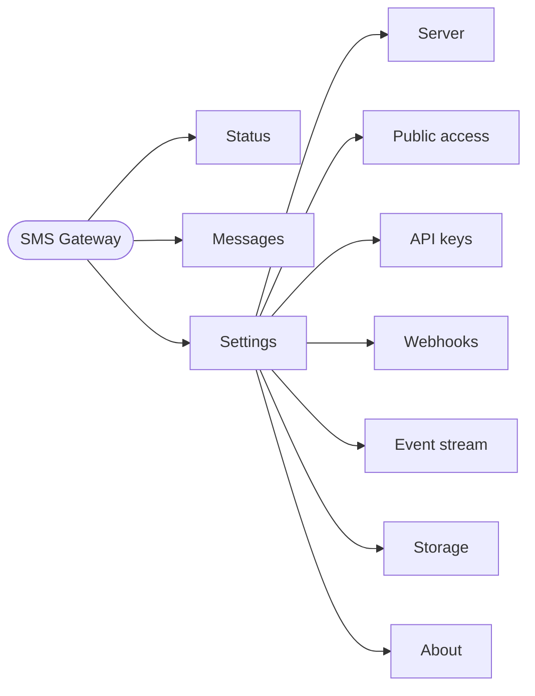

# The app, screen by screen

What each screen of the gateway app shows and what each setting does, with its default. The **?**
at the top of every screen in the app opens the matching part of this guide.

Settings cards are read-only until you tap **Edit**. Nothing changes until you tap **Save**, and
changes that restart the server or affect who can connect ask you to confirm first. **Cancel**, or
Back with unsaved changes, asks before throwing them away.

## Status

The home screen. It doesn't change any settings.

- **Server**: running or stopped, with **Start server** and **Stop server**. If the server couldn't
  start, for example because another app uses the port, the reason is shown here.
- **Reach the API at**: the addresses to use while it runs, such as `http://192.168.1.50:8080`, and
  the tunnel's public URL once it's connected. In **Tunnel only** mode no local address is shown,
  because nothing on the network can connect.
- **Needs attention**: anything that stops the gateway from working well, each with a button that
  fixes it. For example: no API keys yet, battery optimization still on, HTTPS on without a
  certificate, or keys from an older version that should be [reviewed](security.md#keys-from-before-permissions-existed).
- **SIM cards**: each active SIM with its `simSlot` and `subscriptionId`, the values the API uses to
  [pick a SIM](multi-sim.md).

## Messages

The latest 200 messages, newest first, filtered by **All**, **Received** or **Sent**. Each one
shows the number, the SIM, its [status](api.md#message-status), and for sent messages the name of
the API key that sent it. Use [`GET /api/v1/messages`](api.md#get-apiv1messages) for older ones.

## Server

| Setting | Default | What it does |
| --- | --- | --- |
| **Who can connect** | Local network | Which connections are let in at all, before the API key is checked: **Tunnel only**, **Local network** or **Anywhere**. See [Who can connect](security.md#who-can-connect) |
| **Also allow Tailscale addresses** | Off | In **Local network** mode, also let in `100.64.0.0/10`. Leave it off unless you use Tailscale |
| **HTTP port** | `8080` | The plain HTTP port, from 1024 to 65535. If you use the [Cloudflare Tunnel](tunnel.md), point it at this port |
| **Also allow plain HTTP from other devices** | Off | Only matters with HTTPS on. When off, plain HTTP answers only on the phone itself, where the tunnel and the HTTPS listener use it |
| **Start on boot** | Off | Starts the server again after the phone restarts or the app updates |
| **Serve HTTPS** | Off | Encrypts the API on the network. Needs a certificate first. See [HTTPS](https.md) |
| **HTTPS port** | `8443` | Must differ from the HTTP port |

### Certificate

**Set up** (later **Replace**) offers three ways to get a certificate for HTTPS: generate a
**self-signed** one, **paste a certificate and key** (PEM), or pick a **PKCS#12 file**. The card
then shows who it's for, when it expires, and its SHA-256 fingerprint, which clients such as the
[companion app](companion.md#self-signed-certificates) compare before trusting it. See
[HTTPS](https.md).

## Public access

The built-in [Cloudflare Tunnel](tunnel.md), which gives the API a public HTTPS address without
opening ports.

| Setting | Default | What it does |
| --- | --- | --- |
| **Enable tunnel** | Off | Starts the tunnel whenever the server runs. Turning it on asks you to confirm, since it makes the API reachable from the internet |
| **Tunnel token** | none | The token from the Cloudflare dashboard. Stored encrypted. **Remove token** deletes it |
| **Public hostname** | none | Only for display: the app shows it as the public URL, e.g. `https://sms.example.com` |

The **Log** card shows what cloudflared is doing, which helps when a token is rejected or the
tunnel won't connect.

## API keys

Every app or person that uses the API gets its own key. **New key** asks for a name and the
permissions, then shows the key **once**. For each key you can:

- switch it **off** and on again with its switch,
- change its **Permissions**,
- **Regenerate** it: a new value under the same name, and the old one stops working,
- **Revoke** it: deletes the key and the webhooks it added.

| Permission | API scope | Default for a new key |
| --- | --- | --- |
| Send messages | `send` | On |
| Read all messages | `read` | On |
| Follow the event stream | `events` | Off |
| Manage its own webhooks | `webhooks` | Off |
| Send to short codes | `send:shortcode` | Off |

See [API keys](security.md#api-keys) and [Scopes](api.md#scopes).

## Webhooks

- **Webhooks** lists every webhook, whether it was added here or through the API, with the key that
  added it. Switch one off to pause it, or **Delete** it. **Add webhook** asks for a URL and the
  events, then shows its signing secret once.
- **Manage webhooks on this phone only** (off by default) stops the API from adding or removing
  webhooks.
- **Webhook retries**: how long to keep retrying a webhook that fails.

| Setting | Default | What it does |
| --- | --- | --- |
| **Retry interval** | 300 s | The longest wait between attempts, at least 10 seconds |
| **Give up after** | 72 h | Hours from the first attempt, from 1 to 720 (30 days) |

See [Webhooks](webhooks.md).

## Event stream

| Setting | Default | What it does |
| --- | --- | --- |
| **Serve the event stream** | Off | Serves `GET /api/v1/events`, a live stream of the same events webhooks get. Needed for live updates in the [companion app](companion.md) |

While it's on, the card shows how many clients are connected. See [Event stream](events.md).

## Storage

| Setting | Default | What it does |
| --- | --- | --- |
| **Keep messages for** | 30 days | Once a day, older messages are deleted and the database is compacted. `0` keeps them forever. Messages still being sent are always kept |

The **Database** card shows how much space the app's database uses. **Clean up now** runs the daily
cleanup straight away.

## About

The app's version (include it when you [report a problem](https://github.com/jpbaking/sms-gateway-android/issues)),
and links to this guide, the [troubleshooting](troubleshooting.md) page and the source code.
