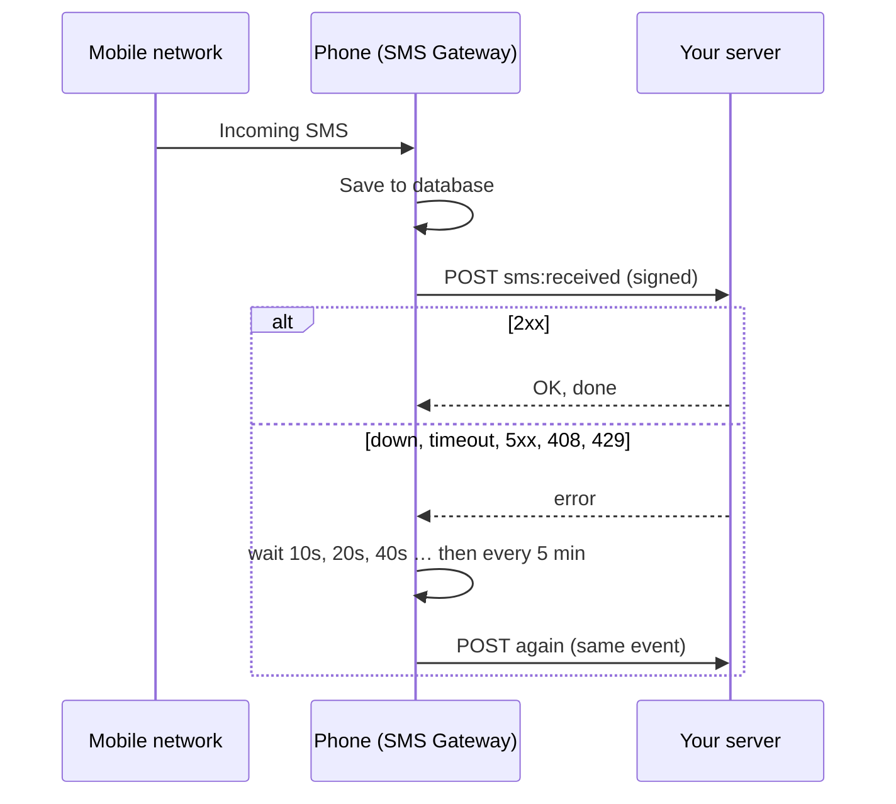

# Webhooks

A webhook is a URL on your server that the phone calls whenever something happens: an SMS arrives,
or a message you sent changes status.



## Register one

```sh
curl -X POST $GW/api/v1/webhooks -H "X-API-Key: $KEY" -H "Content-Type: application/json" \
  -d '{"url": "https://example.com/sms"}'
```

Keep the `secret` from the response. You need it to [verify signatures](#verify-the-signature).
For all options, including extra headers, see the [API reference](api.md#post-apiv1webhooks).

## Events

| Event | When |
| --- | --- |
| `sms:received` | An SMS arrived, on any SIM |
| `sms:sent` | The network accepted every part of a message you sent |
| `sms:delivered` | The recipient's phone confirmed it (needs carrier delivery reports) |
| `sms:failed` | Sending failed. `message.error` says why |

**Every webhook receives every event it subscribes to.** For `sms:sent`, `sms:delivered` and
`sms:failed`, check `message.apiKeyName` to see which of your apps sent the message.

## What you receive

```http
POST /sms HTTP/1.1
Content-Type: application/json; charset=utf-8
User-Agent: sms-gateway-android
X-Gateway-Event: sms:received
X-Gateway-Timestamp: 1762740000
X-Gateway-Signature: sha256=5d41402abc4b2a76b9719d911017c592...
Authorization: Bearer abc123          <- your extra headers, if any

{
  "id": "evt-9a1b…",
  "event": "sms:received",
  "timestamp": 1762740000123,
  "message": {
    "id": "6f1c…", "direction": "in", "phoneNumber": "+15551234567", "body": "STOP",
    "simSlot": 1, "subscriptionId": 2, "status": "received", "...": "…"
  }
}
```

`message` is the same [message object](api.md#the-message-object) the API returns. `id` is unique
per event. If you ever see the same `id` twice, the second one is a retry and you can ignore it.

Reply with any **2xx** status to acknowledge it. Do slow work after replying: the phone waits at most
15 seconds.

## Verify the signature

The signature is an HMAC-SHA256 of `"<X-Gateway-Timestamp>.<raw body>"`, keyed with your webhook's
secret. Compare it in constant time, and reject old timestamps to block replays.

**Python**

```python
import hashlib, hmac, time

def verify(secret: str, headers, raw_body: bytes) -> bool:
    ts = headers["X-Gateway-Timestamp"]
    if abs(time.time() - int(ts)) > 300:
        return False
    expected = "sha256=" + hmac.new(secret.encode(), f"{ts}.".encode() + raw_body, hashlib.sha256).hexdigest()
    return hmac.compare_digest(expected, headers["X-Gateway-Signature"])
```

**Node.js**

```js
const crypto = require("crypto");

function verify(secret, headers, rawBody) {
  const ts = headers["x-gateway-timestamp"];
  if (Math.abs(Date.now() / 1000 - Number(ts)) > 300) return false;
  const expected = "sha256=" + crypto.createHmac("sha256", secret).update(`${ts}.`).update(rawBody).digest("hex");
  const given = headers["x-gateway-signature"] || "";
  return given.length === expected.length && crypto.timingSafeEqual(Buffer.from(given), Buffer.from(expected));
}
```

Use the **raw** request body exactly as received. Parsing the JSON and re-serializing it changes
the bytes and breaks the signature.

## Retries

| Your server answers | What the phone does |
| --- | --- |
| `2xx` | Done |
| No answer, timeout, `5xx`, `408`, `429` | Retries: 10s, 20s, 40s, 80s, 160s, then every **retry interval** |
| Any other `4xx` (e.g. `404`, `401`) | Gives up immediately, since retrying won't help |

On the app's **Webhook retries** card:

- **Retry interval**: the longest wait between attempts. Default 300 seconds (5 minutes).
- **Give up after**: hours from the first attempt. Default `0`, which retries forever.

While the **phone** has no internet, retries pause and don't count as attempts. Deleting a webhook
cancels its pending retries. Retries are saved on the phone, so they survive restarts and reboots.
If a callback is dropped, the message itself is still available from
[`GET /api/v1/messages`](api.md#get-apiv1messages).

## Testing locally

A tiny catcher you can run on your computer. Register `http://<your-computer-ip>:9000/` as the
webhook URL:

```sh
python3 -c '
from http.server import BaseHTTPRequestHandler, HTTPServer
class H(BaseHTTPRequestHandler):
    def do_POST(self):
        body = self.rfile.read(int(self.headers["Content-Length"]))
        print("----\n" + str(self.headers) + body.decode(), flush=True)
        self.send_response(200); self.end_headers()
HTTPServer(("0.0.0.0", 9000), H).serve_forever()'
```

Public request-bin sites work too, but anything you send there, including SMS text, is visible to
that site. Only use them with test messages.
